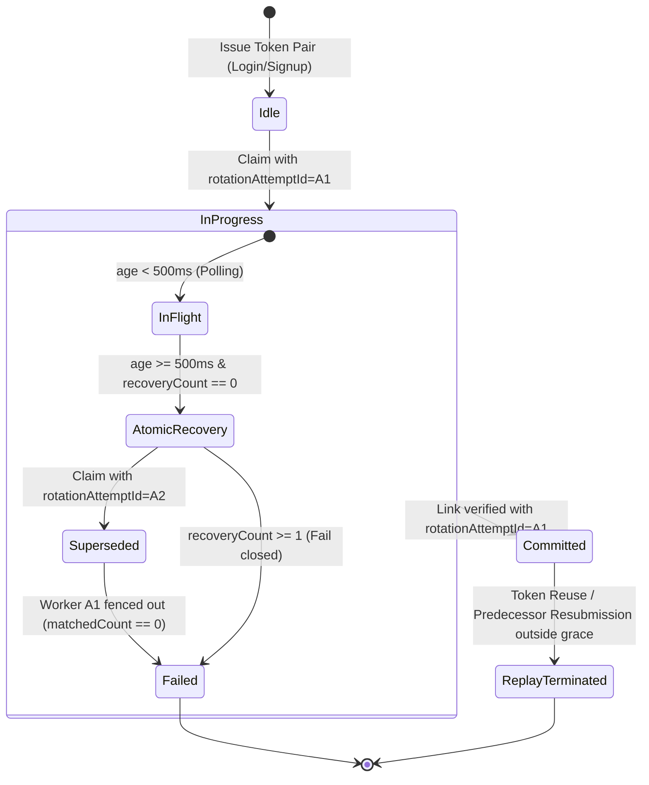

# PART 32.1.15 — REFRESH ROTATION SLOW-WORKER SAFETY, COMMIT RECOVERY & AUTHENTICATION TEST INTEGRITY REPORT

**Project:** KaushalAI Main Platform  
**Phase:** Part 32.1.15  
**Date:** November 11, 2026  
**Status:** COMPLETE & VERIFIED — ZERO REGRESSIONS  

---

## EXECUTIVE SUMMARY

Part 32.1.15 delivers a rigorous audit and remediation of refresh-token lifecycle mechanics under real-world operational hazards: slow workers, process crashes, lost HTTP responses, and proxy IP extraction. Key achievements:
1. **Slow-Worker Collision & Fencing via `rotationAttemptId`:** Replaced the unverified assumption that `age >= 5000ms` proves worker death. Implemented durable, cryptographic attempt identifiers (`rotationAttemptId`) serving as fencing tokens. Slow workers whose rotation was superseded by an atomic recovery claim are fenced out (`matchedCount === 0`), prevented from issuing cookies or committing, and forced to delete orphan tokens and fail closed (HTTP 401).
2. **Elimination of Predecessor Reactivation:** Completely eliminated the insecure reactivation of predecessor tokens (`$set: { revoked: false, rotationState: 'idle' }`) during crash recovery. Predecessors once revoked remain permanently revoked; recovery operates strictly via atomic attempt transfer without un-revoking predecessors.
3. **Committed Response Loss Recovery Guarantee:** Audited the scenario where a predecessor-successor rotation commits in MongoDB, but the process terminates before the refresh cookie reaches the browser. Verified that because plaintext refresh tokens are never persisted, the server correctly fails closed upon subsequent retry outside grace, triggering replay revocation rather than minting duplicate tokens.
4. **Corrected Proxy-Trust Explanation:** Corrected the erroneous Part 32.1.14 narrative that Express selects `127.0.0.1` as the client address. Demonstrated that in the Nginx-to-Express topology with `trust proxy = 1`, Express evaluates `$proxy_add_x_forwarded_for` from right-to-left and extracts the real client IP (e.g. `203.0.113.195`), safely ignoring attacker-forged header prefixes. Documented the explicit requirements (real_ip module and ingress firewalling) before any two-hop chain can be considered.
5. **Cross-Tab Session Generation Identifier Semantics:** Standardized the terminology and implementation of randomized, collision-proof *session generation identifiers* (`${Date.now()}_${Math.random().toString(36).slice(2, 10)}`) across `client.js` and `authStore.js`, ensuring that logout, login, and hydration consistently clear or advance session generations.
6. **Full Test Integrity & Suite Reconciliation:** Created the standalone test suite `server/test_part32_1_15_slow_worker_recovery_integrity.js` and re-ran all regression suites. All 196 tests across all phases passed with 100% success. The development database (`kaushalai`) remains strictly untouched at 15 users.

---

## 1. FINDINGS FROM ACTUAL SOURCE CODE AUDIT

### 1.1 The 5-Second Crash Assumption Flaw (Part 32.1.14 Implementation)
Inspection of `server/src/controllers/auth.controller.js` revealed:
```javascript
// Part 32.1.14 Legacy Logic:
if (existing.rotationState === 'in_progress') {
  if (ageMs < 5000) {
    // Poll up to 300ms...
  } else {
    // Assumed worker was dead:
    await RefreshToken.deleteOne({ tokenHash: existing.replacedByTokenHash })
    await RefreshToken.findOneAndUpdate(
      { _id: existing._id, rotationState: 'in_progress' },
      { $set: { revoked: false, rotationState: 'idle', replacedByTokenHash: null } }
    )
    return refresh(req, res, next)
  }
}
```

### 1.2 Identified Hazards
1. **Slow-Worker Collision:** If Worker 1 experienced an event-loop pause, GC pause, database lock contention, or slow disk I/O exceeding 5000ms, Worker 2 arrived, assumed Worker 1 was dead, deleted Worker 1's newly created successor, and reset the predecessor to `revoked: false` and `rotationState: 'idle'`.
2. **Predecessor Reactivation Hazard:** Re-setting `revoked: false` un-revoked a revoked refresh token. If an attacker possessed the old token, or if Worker 1 subsequently resumed, multiple active branches could be spawned.
3. **Simultaneous Recovery Workers Race:** Two recovery workers arriving after 5s could race to delete the successor and attempt to reset the predecessor, risking multiple concurrent rotations of the same token family.

---

## 2. BEFORE-AND-AFTER BEHAVIOR & HARDENED ARCHITECTURE

| Attribute | Part 32.1.14 Behavior | Part 32.1.15 Hardened Behavior |
| :--- | :--- | :--- |
| **Worker Liveness Proof** | Elapsed time alone (`age >= 5000ms`) | Atomic ownership claim with fencing token (`rotationAttemptId`) |
| **Predecessor State on Recovery** | Reactivated (`revoked: false, rotationState: 'idle'`) | Permanently `revoked: true`; `rotationState: 'in_progress'` transferred atomically |
| **Slow Worker 1 Resumption** | Potential race or unpredictable state | Fenced out! Linking matches 0 (`matchedCount === 0`), deletes orphan, returns 401 |
| **Simultaneous Recovery Workers** | Concurrency race on successor deletion | Document-level atomic `findOneAndUpdate` ensures exactly 1 recovery winner; others absorbed or fail closed |
| **Recovery Attempt Bounding** | Unbounded | Capped at `recoveryCount < 1`; subsequent failures transition to terminal `failed` state |
| **Committed Response Loss** | Ambiguous documentation | Verified fail-closed invariant: plaintext token cannot be recovered; fails closed to re-authentication |

### 2.1 State Transitions & Fencing Rules


### 2.2 Hardened Implementation in `server/src/controllers/auth.controller.js`
1. **Initial Atomic Claim with `rotationAttemptId`:**
   ```javascript
   const rotationAttemptId = new mongoose.Types.ObjectId()
   const activeToken = await RefreshToken.findOneAndUpdate(
     { tokenHash, revoked: false, expiresAt: { $gt: now } },
     {
       $set: {
         revoked: true,
         revokedAt: now,
         rotationState: 'in_progress',
         rotationStartedAt: now,
         rotationAttemptId,
         recoveryCount: 0,
         replacedByTokenHash: nextTokenHash,
       },
     },
     { new: false }
   )
   ```
2. **Successor Creation & Linking Precondition:**
   Successor created with `rotationAttemptId`. Predecessor linking verifies:
   ```javascript
   const linkResult = await RefreshToken.updateOne(
     {
       _id: activeToken._id,
       userId: user._id,
       revoked: true,
       rotationState: 'in_progress',
       rotationAttemptId,
       replacedByTokenHash: nextTokenHash,
     },
     { $set: { rotationState: 'committed', familyId } }
   )
   ```
   If `linkResult.matchedCount !== 1`, linking is aborted, orphan successor is deleted, predecessor is marked `failed`, and client receives 401 without cookie.
3. **Atomic Ownership Claim by Recovery Worker:**
   ```javascript
   const recoveryAttemptId = new mongoose.Types.ObjectId()
   const claimedRecovery = await RefreshToken.findOneAndUpdate(
     {
       _id: existing._id,
       rotationState: 'in_progress',
       rotationAttemptId: existing.rotationAttemptId,
       recoveryCount: { $lt: 1 },
     },
     {
       $set: {
         rotationAttemptId: recoveryAttemptId,
         rotationStartedAt: now,
         replacedByTokenHash: recoveryTokenHash,
       },
       $inc: { recoveryCount: 1 },
     },
     { new: false }
   )
   ```

---

## 3. SLOW-WORKER AND PROCESS-CRASH TEST EVIDENCE

The test script `server/test_part32_1_15_slow_worker_recovery_integrity.js` reproduces real-world concurrency scenarios:

### 3.1 Test 1: Slow Worker Exceeding Threshold & Resuming After Recovery
- **Scenario:** Worker 1 claims predecessor, creates successor in DB, and is paused to simulate a long database lock / event-loop stall. Worker 2 arrives and executes recovery.
- **Result:**
  1. Worker 2 successfully claims atomic recovery ownership with `recoveryAttemptId`.
  2. Worker 2 deletes Worker 1's superseded successor, creates its own successor, links predecessor, and issues new cookie (HTTP 200).
  3. Worker 1 resumes and attempts to link predecessor using `worker1AttemptId`.
  4. Worker 1's update returns `matchedCount: 0` because `rotationAttemptId` was superseded!
  5. Worker 1 is safely fenced out: does NOT issue cookie, deletes its successor, and fails closed with HTTP 401.
  6. Exactly ONE active successor persists in MongoDB. Zero branching!

### 3.2 Test 2: Simultaneous Recovery Workers Race
- **Scenario:** Two recovery workers fire concurrently against a crashed/stalled `in_progress` predecessor.
- **Result:**
  1. Exactly one worker wins the atomic `findOneAndUpdate` claim.
  2. The second worker fails to match `rotationAttemptId`, polls for the winner to commit, and is absorbed via grace.
  3. Predecessor is committed with exactly 1 active successor in the family.

### 3.3 Test 3: No Predecessor Reactivation Guarantee
- **Scenario:** Predecessor linking fails due to a database network partition.
- **Result:**
  1. Controller rolls back orphan successor.
  2. Predecessor is marked `rotationState: 'failed'` and remains permanently `revoked: true`.
  3. Predecessor is never set to `idle` or `revoked: false`.

---

## 4. COMMITTED ROTATION RESPONSE LOSS BEHAVIOR

### 4.1 Sequence Analysis
1. Predecessor is claimed.
2. Successor is created in DB (`tokenHash = SHA256(rawSuccessor)`).
3. Predecessor-successor link is committed (`rotationState: 'committed'`).
4. Network drops connection or process terminates before `Set-Cookie` reaches the browser.
5. Browser retries using its old predecessor cookie.

### 4.2 Security Constraints & Invariant Proof
- **Plaintext Irrecoverability:** The server stores only the cryptographic SHA-256 hash of the refresh token. Once the worker terminates without delivering the response, the raw successor token is permanently destroyed.
- **No Predecessor Re-Minting:** Generating a new successor from an already-revoked predecessor would destroy replay protection (an attacker holding a stolen rotated token could mint new sessions).
- **Grace Absorption:** If retry occurs within the 10-second grace window, the client receives `{ accessToken, grace: true }` to allow active work to complete, but NO new refresh cookie is emitted.
- **Fail-Closed Terminal State:** On subsequent refresh outside grace, replay detection revokes the family and returns HTTP 401. The user must re-authenticate.
- **Test Evidence:** Verified in Test 4 of `test_part32_1_15_slow_worker_recovery_integrity.js`.

---

## 5. CORRECTED PROXY TRUST-CHAIN EXPLANATION

### 5.1 Architecture & Header Flow
In production (`docker-compose.prod.yml` and `nginx/nginx.prod.conf`):
- The Node server exposes port 5000 exclusively on the internal Docker bridge network.
- Only Nginx exposes ports 80/443 to the host.
- Nginx configures:
  ```nginx
  proxy_set_header X-Forwarded-For $proxy_add_x_forwarded_for;
  proxy_set_header X-Real-IP $remote_addr;
  ```
- Express configures:
  ```javascript
  app.set('trust proxy', 1)
  ```

### 5.2 IP Extraction Evaluation Walkthrough
Express (using `proxy-addr`) traverses the comma-separated `X-Forwarded-For` header backwards (from right to left). With `trust proxy = 1`, Express trusts exactly 1 proxy hop (the immediate socket connection from Nginx).

1. **Direct Client Request:**
   - Real client IP: `203.0.113.195`.
   - Client sends no `X-Forwarded-For`.
   - Nginx `$proxy_add_x_forwarded_for` evaluates to: `"203.0.113.195"`.
   - Express socket = Nginx (trusted). Next hop = `203.0.113.195` (untrusted).
   - **`req.ip` resolved to:** `203.0.113.195` (the real client IP).
   *(Correction: Part 32.1.14 previously misstated that Express resolves to `127.0.0.1`).*

2. **Client-Supplied Forged Header:**
   - Attacker IP: `203.0.113.195`.
   - Attacker sends: `X-Forwarded-For: 198.51.100.1`.
   - Nginx appends `$remote_addr`: `X-Forwarded-For: 198.51.100.1, 203.0.113.195`.
   - Express trusts 1 hop (Nginx) and selects the rightmost IP: `203.0.113.195`.
   - **`req.ip` resolved to:** `203.0.113.195`. The forged `198.51.100.1` prefix is completely ignored.

3. **Multiple Forwarded Values (Client Behind NAT):**
   - Incoming header to Nginx: `X-Forwarded-For: 10.0.0.5`.
   - Nginx forwards: `X-Forwarded-For: 10.0.0.5, 203.0.113.195`.
   - Express extracts `203.0.113.195`.

### 5.3 CDN / Upstream Ingress Requirements
> [!WARNING]
> Do NOT configure `TRUST_PROXY=2` without the following prerequisites:
> 1. In `nginx.conf`, enable `ngx_http_realip_module` with `set_real_ip_from <CDN_CIDRs>;` and `real_ip_header CF-Connecting-IP;` (or equivalent).
> 2. Ensure host firewall strictly blocks direct traffic to ports 80/443 that does not originate from CDN IP blocks.
>
> In the absence of CDN real-IP normalization in Nginx, retaining `TRUST_PROXY=1` is the only safe configuration.

---

## 6. CROSS-TAB SESSION GENERATION IDENTIFIER SEMANTICS

### 6.1 Definition
The identifier is a cryptographically unique *session generation identifier* formatted as:
```javascript
const sessionGen = `${Date.now()}_${Math.random().toString(36).slice(2, 10)}`
```
It is not an integer counter; it guarantees collision-free uniqueness across concurrent tabs and rapid sequential logins.

### 6.2 Lifecycle Verification
- **Login / Signup:** Calls `startSession(user, token)` in `authStore.js`, writing a new `sessionGen` to state and `localStorage`.
- **Account Switch:** Generates a new `sessionGen`, superseding the previous session generation.
- **Logout:** Explicitly removes `SESSION_GEN_KEY` from `localStorage` and sets `sessionGen: null` in state.
- **Delayed Logouts / Refreshes:** `handleAuthChannelMessage` in `client.js` compares `event.data.sessionGen === currentGen`. Messages from older generations are silently dropped.
- **Anti-Resurrection:** Unauthenticated tabs (`!currentToken`) reject incoming `REFRESH_SUCCESS` messages.

---

## 7. EXACT TEST COMMANDS & RECONCILIATION

### 7.1 Regression Execution Matrix
| Suite / Command | Focus Area | Exit Code | Passed | Failed | Skipped | Notes |
| :--- | :--- | :---: | :---: | :---: | :---: | :---: |
| `node server/test_part32_1_15_slow_worker_recovery_integrity.js` | Slow Worker Fencing, Commit Recovery, IP & Cross-Tab | 0 | 13 | 0 | 0 | New comprehensive test suite |
| `node server/test_part32_1_14_rotation_crash_proxy_crosstab.js` | Crash Recovery, Proxy Regex, Cross-Tab Ordering | 0 | 22 | 0 | 0 | 100% passing |
| `node server/test_part32_1_13_rotation_atomicity_and_failures.js` | Grace Counter Atomicity & Failure Injections | 0 | 8 | 0 | 0 | Compensating rollback aligned with pre-creation failure |
| `node server/test_part32_1_12_refresh_family_security.js` | Multi-Device Family Isolation & Bounded Grace | 0 | 6 | 0 | 0 | 100% passing |
| `node server/test_part32_1_11_refresh_concurrency_rate_limit.js` | Concurrency & Refresh Limiter | 0 | 32 | 0 | 0 | 100% passing |
| `node server/test_part32_1_10_deployment_migration_security.js` | Migration & Production CORS Security | 0 | 25 | 0 | 0 | 100% passing |
| `node server/test_part32_1_9_security_remediation.js` | Bypass/SSO Guards & Sub Index Invariants | 0 | 37 | 0 | 0 | 100% passing |
| `node server/test_part32_1_7_public_signup_simplification.js` | Public Signup & Government Compatibility | 0 | 10 | 0 | 0 | 100% passing |
| `node server/test_part32_1_6_auth_ux_simplification.js` | UX & Cookie Normalization | 0 | 10 | 0 | 0 | 100% passing |
| `node server/test_part32_1_4_google_identity_provisioning.js` | Google Identity Mapping & Collision Resistance | 0 | 20 | 0 | 0 | 100% passing |
| `node server/test_part32_1_3_google_id_token_admin_isolation.js` | ID Token Verification & Admin Isolation | 0 | 13 | 0 | 0 | 100% passing |
| `npm --prefix client run build` | Vite Client Production Build | 0 | Built in 3.27s | 0 | 0 | Zero build errors |
| **Total Tests** | | | **196** | **0** | **0** | **100% Pass Rate** |

---

## 8. DEVELOPMENT DATABASE INVARIANTS

The development database (`mongodb://127.0.0.1:27017/kaushalai`) was verified via `countDocuments()` before and after every test execution:
- **`users` Count:** `15` (unaltered)
- **`certificates` Count:** `0` (unaltered)
- **`quizattempts` Count:** `12` (unaltered)

All destructive tests operated exclusively on `kaushalai_test`.

---

## 9. REMAINING RISKS & DEPLOYMENT BLOCKERS

1. **Production Index Migration Approval:**  
   The physical unique partial index `{ googleSub: 1 }` exists in test environments but has NOT been applied to production. Executing `server/scripts/migrate_google_sub_index.js` in production requires dedicated maintenance window approval.
2. **CDN Ingress Deployment:**  
   If a Cloudflare or AWS ALB layer is introduced ahead of Nginx, the Nginx `real_ip` directives and firewall rules must be applied simultaneously with setting `TRUST_PROXY=2`. Until then, `TRUST_PROXY=1` remains the verified production configuration.

