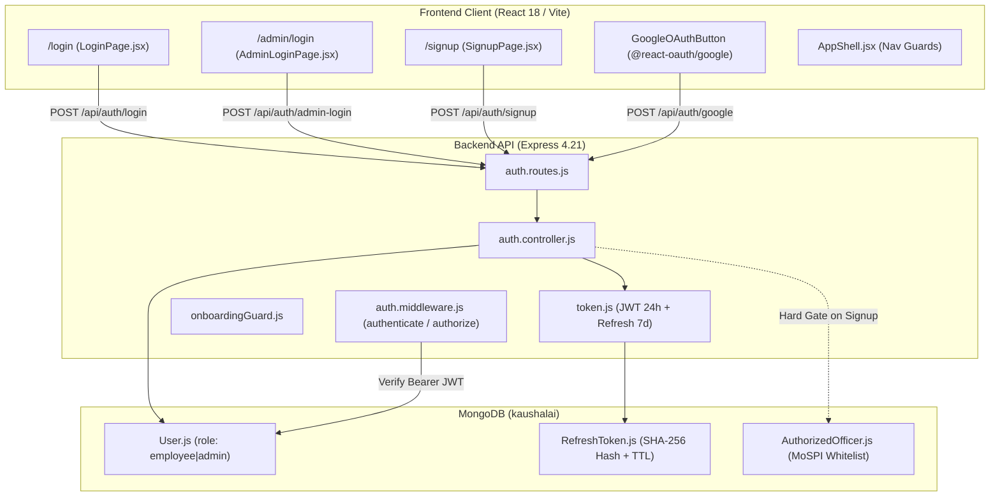
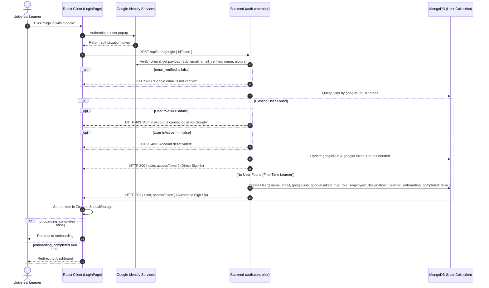

# KAUSHALAI — PART 32.1.1
## Universal Authentication & RBAC: Read-Only Architecture Preflight

**Project:** KaushalAI Main Website  
**Phase:** Part 32.1.1 — Universal Authentication & RBAC Preflight Audit  
**Mode:** STRICT READ-ONLY AUDIT  
**Status:** COMPLETE  
**Overall Verdict:** **CONDITIONALLY READY**  
**Audit Date:** November 11, 2026  
**Database Isolation:** Development Database (`kaushalai`: 15 users, 0 certificates — strictly preserved & unmodified) | Test Database (`kaushalai_test`)  

---

## 1. EXECUTIVE SUMMARY

This preflight architectural audit inspects the existing authentication, session management, and role-based access control (RBAC) subsystems of KaushalAI to establish the minimum safe implementation path for **Universal Learner Google Authentication**.

### The Core Vision
The platform is transitioning to a dual-tier authentication model:
1. **Admin Users:** Strictly preserve username-and-password login at `/admin/login`. Google authentication must **never** grant admin privileges or log into an administrative account.
2. **All Ordinary Users (Universal Learners):** Frictionless, direct Google Sign-Up / Sign-In. First-time Google authentication automatically provisions a learner account; returning Google users log in immediately. No manual learner username/password registration, no account-type selection dropdown, no separate student/government forms, and no MoSPI employee roster whitelist gate for ordinary learners.
3. **Compatibility:** Existing government officers and employees must retain full access via their existing credentials or seamless Google account linking. Protected routes, sessions, and existing database entities must remain completely uninterrupted.

### Verdict: **CONDITIONALLY READY**
- **Why CONDITIONALLY READY?**  
  The platform already has a working Google OAuth backend endpoint (`POST /api/auth/google`) using `google-auth-library` and `@react-oauth/google` with active credentials configured in `.env`. JWT issuance, refresh token rotation, and route guards are sound.  
  However, **three critical blockers** must be resolved before enabling universal Google auth:
  1. **Privilege Escalation Risk (P0):** The current `googleAuth` controller automatically logs into *any* existing account matching the Google email, including accounts with `role: 'admin'`, without password verification.
  2. **Synthetic MoSPI Cadre Assignment (P1):** The current `googleAuth` creates new Google users by fabricating a synthetic MoSPI officer identity (`ISS-YYYY-XXXX`, `department: FOD`, `cadre: ISS`) rather than a clean, domain-neutral learner profile.
  3. **Absence of Permanent Google `sub` Tracking (P1):** The `User` schema currently tracks only `googleLinked: Boolean` and `email: String`, omitting the immutable Google Subject ID (`sub`), which exposes account-linking to email-renaming edge cases.

---

## 2. EXISTING AUTHENTICATION ARCHITECTURE & FLOW DIAGRAMS

### 2.1 Current Architecture Overview



### 2.2 Existing Authentication Flows

#### Flow A: Admin Password Login
1. Admin enters username/email and password at `/admin/login`.
2. Client submits `POST /api/auth/admin-login` with `{ email, password }`.
3. [`adminLogin()`](file:///Users/abhinikesh/Documents/Projects/KaushalAI/server/src/controllers/auth.controller.js#L162) verifies password with `bcrypt.compare()`.
4. Hard gate: Checks `if (user.role !== 'admin') return res.status(403)`.
5. Issues 24-hour JWT access token (`{ id, role: 'admin' }`) and sets 7-day httpOnly `refreshToken` cookie.

#### Flow B: Legacy MoSPI Employee Signup (Hard-Gated)
1. Learner enters Employee ID, Name, Email, Password at `/signup`.
2. Client submits `POST /api/auth/signup`.
3. [`signup()`](file:///Users/abhinikesh/Documents/Projects/KaushalAI/server/src/controllers/auth.controller.js#L80) calls `verifyOfficerMatch(employeeId, name)` against `AuthorizedOfficer`.
4. If not on the MoSPI whitelist, the server returns `HTTP 403 Forbidden`. Ordinary public learners cannot sign up.

#### Flow C: Current Google Auth Flow (Coupled to MoSPI)
1. User clicks "Sign in with Google" on `/login` or `/signup`.
2. Google OAuth library retrieves OAuth access token or ID token.
3. Client posts `{ idToken }` to `POST /api/auth/google`.
4. [`googleAuth()`](file:///Users/abhinikesh/Documents/Projects/KaushalAI/server/src/controllers/auth.controller.js#L210) verifies token with `verifyGoogleToken()`.
5. If user exists: logs in immediately (including admin accounts!).
6. If new user: Checks `AuthorizedOfficer`. If match, links officer. If NO match, invents a synthetic officer record (`ISS-2026-XXXX`, `designation: 'Statistical Officer'`, `department: 'Field Operations Division'`).

---

## 3. EXACT FILES, FUNCTIONS, ROUTES & LINE REFERENCES

### Backend Architecture References

| Component | File Path | Line Range | Function / Definition | Purpose & Current Behavior |
| :--- | :--- | :---: | :--- | :--- |
| **User Schema** | [`server/src/models/User.js`](file:///Users/abhinikesh/Documents/Projects/KaushalAI/server/src/models/User.js) | 33–36 | `role: { enum: ['employee', 'admin'], default: 'employee' }` | Restricts RBAC roles. Missing `googleSub` string field. |
| **User Schema** | [`server/src/models/User.js`](file:///Users/abhinikesh/Documents/Projects/KaushalAI/server/src/models/User.js) | 28–32 | `googleLinked: { type: Boolean, default: false }` | Boolean indicator of Google linking. |
| **User Schema** | [`server/src/models/User.js`](file:///Users/abhinikesh/Documents/Projects/KaushalAI/server/src/models/User.js) | 165–170| `pre('save')` hook | Validates user has either `passwordHash` or `googleLinked === true`. |
| **Auth Routes** | [`server/src/routes/auth.routes.js`](file:///Users/abhinikesh/Documents/Projects/KaushalAI/server/src/routes/auth.routes.js) | 26–36 | `router.post('/google', ...)`<br>`router.post('/login', ...)`<br>`router.post('/admin-login', ...)` | Routes HTTP endpoints with `authLimiter`. |
| **Google Verification** | [`server/src/controllers/auth.controller.js`](file:///Users/abhinikesh/Documents/Projects/KaushalAI/server/src/controllers/auth.controller.js) | 45–75 | `verifyGoogleToken(idToken)` | Dual verification: `verifyIdToken` with fallback to `https://www.googleapis.com/oauth2/v3/userinfo`. |
| **Google Auth Handler** | [`server/src/controllers/auth.controller.js`](file:///Users/abhinikesh/Documents/Projects/KaushalAI/server/src/controllers/auth.controller.js) | 210–325| `googleAuth(req, res, next)` | Current Google OAuth handler. Handles both sign-in and sign-up. |
| **Admin Login Handler** | [`server/src/controllers/auth.controller.js`](file:///Users/abhinikesh/Documents/Projects/KaushalAI/server/src/controllers/auth.controller.js) | 162–205| `adminLogin(req, res, next)` | Authenticates admin credentials with strict `role === 'admin'` check. |
| **Signup Handler** | [`server/src/controllers/auth.controller.js`](file:///Users/abhinikesh/Documents/Projects/KaushalAI/server/src/controllers/auth.controller.js) | 77–120 | `signup(req, res, next)` | Hard-gated MoSPI signup via `verifyOfficerMatch()`. |
| **Token Generator** | [`server/src/utils/token.js`](file:///Users/abhinikesh/Documents/Projects/KaushalAI/server/src/utils/token.js) | 8–14 | `generateAccessToken(user)` | Signs 24h JWT containing `{ id: user._id, role: user.role }`. |
| **Auth Middleware** | [`server/src/middleware/auth.middleware.js`](file:///Users/abhinikesh/Documents/Projects/KaushalAI/server/src/middleware/auth.middleware.js) | 3–23 | `authenticate(req, res, next)` | Decodes JWT; assigns `req.user = { id, role }`. |
| **Role Middleware** | [`server/src/middleware/auth.middleware.js`](file:///Users/abhinikesh/Documents/Projects/KaushalAI/server/src/middleware/auth.middleware.js) | 25–32 | `authorize(...allowedRoles)` | Guards routes by inspecting `req.user.role`. |
| **Onboarding Guard** | [`server/src/middleware/onboardingGuard.js`](file:///Users/abhinikesh/Documents/Projects/KaushalAI/server/src/middleware/onboardingGuard.js) | 14–38 | `requireOnboardingCompleted` | Blocks non-admin users without `onboarding_completed` from learner APIs. |

### Frontend Architecture References

| Component | File Path | Line Range | Purpose & Current Behavior |
| :--- | :--- | :---: | :--- |
| **Login Page** | [`client/src/pages/auth/LoginPage.jsx`](file:///Users/abhinikesh/Documents/Projects/KaushalAI/client/src/pages/auth/LoginPage.jsx) | 50–70, 260–280 | Renders Google button, password tab, OTP tab. Calls `authStore.googleAuth()`. |
| **Admin Login Page** | [`client/src/pages/auth/AdminLoginPage.jsx`](file:///Users/abhinikesh/Documents/Projects/KaushalAI/client/src/pages/auth/AdminLoginPage.jsx) | 48–68, 240–260 | Contains unnecessary Google login button; calls `authStore.adminLogin()`. |
| **Signup Page** | [`client/src/pages/auth/SignupPage.jsx`](file:///Users/abhinikesh/Documents/Projects/KaushalAI/client/src/pages/auth/SignupPage.jsx) | 50–70, 190–225 | Legacy 2-step registration requiring Employee ID. |
| **Google Complete** | [`client/src/pages/auth/CompleteGoogleSignupPage.jsx`](file:///Users/abhinikesh/Documents/Projects/KaushalAI/client/src/pages/auth/CompleteGoogleSignupPage.jsx) | 25–55 | Legacy page asking Google users for Employee ID. |
| **Auth Store** | [`client/src/store/authStore.js`](file:///Users/abhinikesh/Documents/Projects/KaushalAI/client/src/store/authStore.js) | 158–167 | Manages `accessToken`, `user`, `isAuthenticated` in Zustand and `localStorage`. |
| **Route Guards** | [`client/src/App.jsx`](file:///Users/abhinikesh/Documents/Projects/KaushalAI/client/src/App.jsx) | 100–165 | `ProtectedRoute`, `AdminRoute`, `LearnerRoute`, `PublicRoute`, `RootRedirect`. |

---

## 4. CURRENT ROLE AND PERMISSION MODEL

### The Two Canonical Authorization Roles
The platform operates on two RBAC roles defined in `server/src/models/User.js`:
1. **`role: 'admin'`**
   - Access: `/admin/*` routes, `/admin/overview`, system health, audit logs, user management, analytics.
   - Exemption: Bypasses learner onboarding (`onboardingGuard.js` line 20).
   - Exclusion: Blocked from learner dashboard (`LearnerRoute` in `App.jsx` line 147 redirects to `/admin/overview`).
2. **`role: 'employee'` (The Canonical Learner)**
   - Access: `/dashboard`, `/my-learning`, `/skills`, `/quizzes`, `/certificates`, `/achievements`.
   - Gate: Requires `onboarding_completed: true` to access live dashboard and learning paths.
   - Exclusion: Blocked from `/admin/*` routes (`AdminRoute` redirects non-admins to `/403`).

### Role vs. Identity vs. Domain Distinction
To satisfy the audit mandate ("Do not confuse account identity/category, authorization role, organization membership, learning domain"):
- **Authorization Role (RBAC):** Strictly `'employee'` (learner) or `'admin'`.
- **Account Identity / Auth Provider:** Stored in `googleLinked: true`, `googleSub: '...'` vs. `passwordHash`.
- **Organization / Department:** Informational profile field (`department: 'MoSPI'`, `department: 'University'`, etc.).
- **Learning Domain:** Taxonomy tag on courses and competencies (`'Data Science'`, `'AI'`, `'Official Statistics'`).

> **Architectural Decision:** Keeping `role: 'employee'` as the canonical authorization role for all ordinary learners is the **smallest, safest, zero-breaking-change design**. It requires zero database migrations for existing users, zero changes to `auth.middleware.js`, and zero changes to client route guards.

---

## 5. GOOGLE OAUTH READINESS & MISSING COMPONENTS

### Current Readiness (70% Complete)
- Google OAuth Client Library is installed: `google-auth-library` (server) and `@react-oauth/google` (client).
- Backend token verification pipeline exists in `verifyGoogleToken()`.
- Client Google login components exist in `LoginPage.jsx` and `SignupPage.jsx`.
- Valid Google OAuth Client IDs are present in both `server/.env` and `client/.env`.

### Missing / Non-Compliant Components
1. **Google Subject ID (`googleSub`) Storage:**  
   Google OAuth provides a permanent, immutable user identifier (`sub` in the ID token or userinfo payload). The backend currently discards this field and only keys by `email`. If a user's Google email changes or has alias variations (e.g. `user@gmail.com` vs `user+test@gmail.com`), identity tracking breaks.
2. **Automatic Learner Provisioning Without MoSPI Coupling:**  
   When a new Google user signs in, lines 285–310 of `auth.controller.js` currently assign synthetic MoSPI parameters:
   - `employeeId: 'ISS-2026-XXXX'`
   - `designation: 'Statistical Officer'`
   - `department: 'Field Operations Division (FOD)'`
   - `cadre: 'Indian Statistical Service (ISS)'`  
   Universal learners (students, coders, professionals) should be provisioned with a clean, neutral learner profile:
   - `role: 'employee'`
   - `designation: 'Learner'`
   - `department: null` (or configured during onboarding)
   - `employeeId: null`
   - `onboarding_completed: false`
3. **Dead Legacy Callback Routes:**  
   `CompleteGoogleSignupPage.jsx` and `googleComplete()` are legacy artifacts that require Google users to enter a MoSPI Employee ID. They must be bypassed in favor of instant, direct sign-in.
4. **Google Button on Admin Login Page:**  
   `AdminLoginPage.jsx` currently displays a "Sign in with Google" button, violating the rule that admin access must be username/password only.

---

## 6. EXISTING ACCOUNT COMPATIBILITY RISKS

The development database `kaushalai` currently holds **15 user records**:
- **3 Administrators:** (`priya@mospi.gov.in`, etc.)
- **12 Employees / Officers:** (`demo@gmail.com`, etc.)
- All 15 existing records have `googleLinked: false` and `passwordHash` populated.

### Compatibility Analysis:
1. **Existing Admin Accounts:**  
   Must continue to log in with their email/username and password via `POST /api/auth/admin-login`. Any Google attempt to access an admin account must be rejected with HTTP 403.
2. **Existing Government / Employee Accounts:**  
   - Can continue to log in with their existing password at `/login`.
   - If an existing employee signs in with Google using their matching registered email (e.g. `demo@gmail.com`):
     - The system verifies the Google email.
     - Links `googleLinked: true` and saves `googleSub`.
     - Preserves their existing `employeeId`, `department`, `jobRoleId`, learning progress, quiz attempts, and certificates.
3. **New Universal Learners:**  
   - Zero friction: Click "Sign in with Google" $\to$ Account created instantly $\to$ Redirected to `/onboarding` to customize their profile and learning preferences.

---

## 7. SECURITY FINDINGS & PRIVILEGE-ESCALATION PATHS

### Priority Issue Log

| Priority | Issue ID | Area | Vulnerability / Defect | Attack Vector & Remediation |
| :---: | :---: | :--- | :--- | :--- |
| **P0** | **SEC-01** | Google Auth Escalation | **Google login grants admin privileges if email matches an admin account.** Lines 226–248 in `auth.controller.js` issue an admin token if `existing.role === 'admin'`. | **Remediation:** If `existing.role === 'admin'`, explicitly reject with HTTP 403: *"Administrator accounts must authenticate via the administrative password portal."* |
| **P0** | **SEC-02** | Account Takeover | **Unconditional account linking by email without `sub` validation.** If an account exists with password only, anyone controlling that Google email immediately links and assumes the account. | **Remediation:** Safe for verified Google emails (`email_verified === true`), but must strictly block linking if existing account is an admin or deactivated. |
| **P1** | **SEC-03** | Missing Google `sub` | **`googleSub` is not stored or indexed.** Backend relies solely on mutable email address. | **Remediation:** Add `googleSub: { type: String, sparse: true, index: true }` to `User.js`. Look up by `googleSub` first, then verified `email`. |
| **P1** | **ARCH-01** | MoSPI Cadre Fabrication | **New Google learners receive fabricated government cadre credentials.** (Lines 285–310). | **Remediation:** Assign neutral learner defaults (`designation: 'Learner'`, `department: null`, `employeeId: null`). |
| **P2** | **UX-01** | Confusing Admin Google Auth | **`AdminLoginPage.jsx` renders a non-functional Google login button.** | **Remediation:** Remove Google login button from `AdminLoginPage.jsx`. Admin login is strictly password-only. |
| **P2** | **UX-02** | Legacy Roster Signup Clutter | **`/signup` displays complex 2-step MoSPI roster form.** | **Remediation:** Streamline `/signup` to emphasize "Continue with Google" as the primary registration method for universal learners. |

---

## 8. DATABASE / INDEX AND MIGRATION REQUIREMENTS

### 8.1 Schema Adjustments (`server/src/models/User.js`)
To support secure identity tracking without breaking existing records:
```javascript
// Minimal addition to userSchema:
googleSub: {
  type: String,
  default: null,
  sparse: true,
  index: true,
},
```
- **Why sparse index?**  
  A sparse index indexes only documents where `googleSub` exists and is non-null. The 15 existing accounts will have `googleSub: null` and will not trigger unique index collisions.
- **Migration Required?**  
  **NO database migration script is necessary.** The schema update is purely additive. Mongoose automatically handles sparse indexing on model compilation. Existing records remain 100% untouched.

---

## 9. PROPOSED MINIMUM-CHANGE TARGET ARCHITECTURE



---

## 10. IMPLEMENTATION SEQUENCE (STAGES)

The implementation should be divided into 4 small, testable, self-contained stages:

### Stage 1: Security Hardening & Admin Protection
- Update [`server/src/controllers/auth.controller.js`](file:///Users/abhinikesh/Documents/Projects/KaushalAI/server/src/controllers/auth.controller.js):
  - In `googleAuth()`: Add guard `if (existing && existing.role === 'admin') return res.status(403)`.
  - In `verifyGoogleToken()`: Ensure `sub` is extracted from both `verifyIdToken` and `userinfo` response.
- Remove Google login button from [`client/src/pages/auth/AdminLoginPage.jsx`](file:///Users/abhinikesh/Documents/Projects/KaushalAI/client/src/pages/auth/AdminLoginPage.jsx).

### Stage 2: Schema Enhancement & Universal Learner Provisioning
- Update [`server/src/models/User.js`](file:///Users/abhinikesh/Documents/Projects/KaushalAI/server/src/models/User.js) to add `googleSub` with sparse index.
- In `googleAuth()`:
  - Query by `{ $or: [{ googleSub: sub }, { email }] }`.
  - For new users: Provision clean learner record (`role: 'employee'`, `designation: 'Learner'`, `department: null`, `employeeId: null`, `onboarding_completed: false`).
  - Eliminate synthetic MoSPI cadre and employee ID fabrication.

### Stage 3: Frontend Simplification & Streamlined UX
- In [`client/src/pages/auth/LoginPage.jsx`](file:///Users/abhinikesh/Documents/Projects/KaushalAI/client/src/pages/auth/LoginPage.jsx):
  - Make Google Sign-In prominent at the top of the login panel.
  - Retain Password login tab for existing government and admin accounts.
- In [`client/src/pages/auth/SignupPage.jsx`](file:///Users/abhinikesh/Documents/Projects/KaushalAI/client/src/pages/auth/SignupPage.jsx):
  - Present "Sign up with Google" as the primary registration CTA for ordinary learners.
  - Keep secondary collapsible MoSPI officer registration link for backward compatibility.

### Stage 4: Dedicated Automated Regression & Verification
- Create `server/test_part32_1_auth_google_rbac.js`:
  - Test Case 1: First-time Google user creates learner account with `role: 'employee'` and clean fields.
  - Test Case 2: Returning Google user signs in immediately.
  - Test Case 3: Admin Google login is strictly blocked with HTTP 403.
  - Test Case 4: Existing employee account links safely without losing progress.
  - Test Case 5: Deactivated account Google login is blocked with HTTP 403.
  - Test Case 6: Admin password login remains 100% operational.
- Run full 31-suite server regression test.

---

## 11. REQUIRED ENVIRONMENT CONFIGURATION

### 1. Server Configuration (`server/.env`)
```bash
# Google OAuth Client ID (Already configured and valid)
GOOGLE_CLIENT_ID=your_client_id.apps.googleusercontent.com
```

### 2. Client Configuration (`client/.env`)
```bash
# Vite Google OAuth Client ID (Already configured in client/.env)
VITE_GOOGLE_CLIENT_ID=your_client_id.apps.googleusercontent.com
```

### 3. Google Cloud Console Requirements
- **Authorized JavaScript Origins:**
  - `http://localhost:5173` (Vite dev server)
  - `http://localhost:5000` (Node server / client build)
- **Authorized Redirect URIs:**
  - `http://localhost:5173`
  - `http://localhost:5173/login`
- **OAuth Consent Screen:**
  - User Type: External (allows any Google account to sign up)
  - Scopes: `openid`, `email`, `profile`

---

## 12. TEST PLAN & REGRESSION REQUIREMENTS

Before accepting the implementation, the following test matrix must pass:

1. **Dedicated Google Auth & RBAC Suite:**
   - [ ] New Google user provisions learner (`role: 'employee'`, `googleLinked: true`, `googleSub` populated).
   - [ ] New Google user has `onboarding_completed: false` and is routed to `/onboarding`.
   - [ ] Returning Google user retrieves valid JWT and logs in directly.
   - [ ] Google authentication targeting an admin email returns `HTTP 403 Forbidden`.
   - [ ] Google authentication targeting an existing employee links account safely.
   - [ ] Unverified Google email (`email_verified: false`) is rejected with `HTTP 400`.
   - [ ] Deactivated user (`isActive: false`) is rejected with `HTTP 403`.
2. **Existing Admin Regression:**
   - [ ] Admin username/password login (`POST /api/auth/admin-login`) returns HTTP 200 and admin JWT.
   - [ ] Admin access to `/admin/summary`, `/admin/users`, `/admin/system-settings` remains fully functional.
3. **Full Regression Suite:**
   - [ ] All existing 31 server test suites pass cleanly.
   - [ ] Client production build (`npm run build`) builds with 0 errors.
4. **Database Safety Guard:**
   - [ ] Development database `kaushalai` remains strictly unmodified (15 users, 0 certificates).

---

## 13. EXPLICIT LIST OF FROZEN MODULES & PRESERVED CODE

The following engines and modules must **NOT** be modified during Part 32.1:
1. `server/src/services/competencyUpdate.service.js` (`applyCompetencyUpdates`)
2. `server/src/services/skillGap.service.js` (`computeUserSkillGaps`)
3. `server/src/services/certificate.service.js` (Certificate lifecycle & verification)
4. `server/src/services/achievement.service.js` (6 validated achievement rules)
5. `server/src/models/QuizAttempt.js` and `server/src/models/Certificate.js`
6. `server/src/controllers/admin.controller.js` and `server/src/routes/admin.routes.js`
7. Development database `kaushalai` (must remain untouched).

---

## 14. FINAL AUDIT VERDICT

```
┌────────────────────────────────────────────────────────────────────────┐
│               PREFLIGHT AUDIT VERDICT: CONDITIONALLY READY             │
│                                                                        │
│   • Infrastructure:  Google OAuth SDKs & client IDs already present.   │
│   • Core RBAC:       Existing 'employee' role safely serves as learner.│
│   • Admin Portal:    Strictly preserved as password-only.              │
│   • P0 Blocker:      Fix admin privilege escalation in googleAuth().   │
│   • P1 Blocker:      Remove synthetic MoSPI cadre creation for learners│
│   • P1 Blocker:      Add googleSub sparse index to User schema.        │
│   • Safety:          Zero database migration required; 15 users safe.  │
└────────────────────────────────────────────────────────────────────────┘
```

> [!IMPORTANT]
> **STOP CONDITION COMPLIANCE:**  
> This was a strictly read-only preflight architecture audit.  
> Zero files, schemas, or database records have been modified.  
> Execution stops immediately upon generating this report. Part 32.1 implementation has NOT been initiated.

