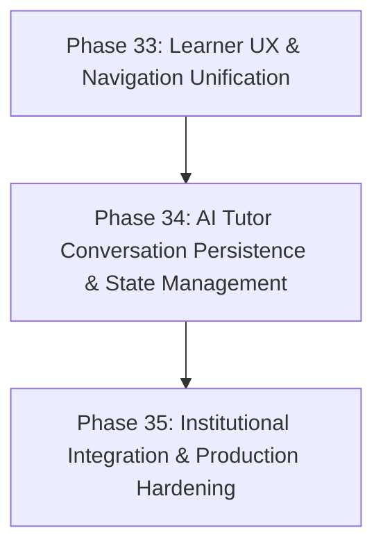

# KaushalAI — Post-Authentication Product Completion Audit

**Project:** KaushalAI Main Platform  
**Audit Date:** 11 November 2026  
**Audit Mode:** Strictly READ-ONLY (Zero code changes, zero schema migrations, zero DB mutations)  
**Authentication State:** Part 32.1 FROZEN (Universal Auth, Google ID-token, Admin Isolation, Refresh Concurrency, Family Recovery)  
**Development Database:** `mongodb://127.0.0.1:27017/kaushalai` (Confirmed strictly untouched: 15 users, 0 certificates)  
**Test Database:** `mongodb://127.0.0.1:27017/kaushalai_test` (Isolated test fixtures only)

---

## Executive Summary

Following the formal closure of Authentication Hardening (Part 32.1), this audit provides a comprehensive, evidence-based assessment of the remaining learner and administrative functionality in the KaushalAI platform.

The audit was conducted by inspecting source code across the Vite/React frontend and Express/Node.js backend, querying MongoDB collection states, executing all existing non-authentication automated test suites, and performing cross-module data-flow analysis.

### Overall Platform Health Matrix

| # | Module | Status | Core Architecture | Verified Tests |
|---|---|:---:|---|:---:|
| 1 | **Learning Path & Recommendations** | `COMPLETE` | Multi-tier pipeline: AI microservice + local fallback | Part 10.2, Part 22 |
| 2 | **Course Catalogue, Details, Enrollment & Progress** | `COMPLETE` | Anti-reversion progress, certificate trigger on 100% | Part 22 |
| 3 | **Course Completion & Competency Framework** | `COMPLETE` | Monotonic leveling via assessment evidence | Part 17.2, Part 23.1, 23.2 |
| 4 | **AI Tutor & Conversation Persistence** | `PARTIAL` | Multi-LLM provider, but **session persistence is missing** | Part 14 |
| 5 | **Admin Dashboard, Analytics & Governance** | `COMPLETE` | Atomic role reassignment, real DB aggregations | Part 21, Part 21.2 |
| 6 | **Assessments, Quizzes, History & Results** | `COMPLETE` | 20-min timed diagnostic, autosave, anti-leak | Step 5, Step 6 |
| 7 | **Certificates, Issuance & Public Verification** | `COMPLETE` | Anti-tamper verification, privacy sanitization | Part 24.2, Part 24.2.2.1/2 |
| 8 | **Notifications & Learner Activity** | `COMPLETE` | Deterministic badge engine, unified activity timeline | Part 24.1, Part 24.1.2 |
| 9 | **iGOT Integration & Institutional Functions** | `PARTIAL` | Working mock adapter; **live external HTTP client is stub** | Part 22 |
| 10 | **Settings, Profile, Permissions & Navigation** | `PARTIAL` | RBAC & preferences work; **sidebar navigation omissions** | AppShell audit |

---

## Detailed Module-by-Module Assessment

### Module 1: Learning Path & Personalized Learning Recommendations
* **Status:** `COMPLETE` (with documented local fallback when external AI microservice is offline)
* **Verified Working Functionality:**
  - Sequenced milestones (1..N) stored in `LearningPath` and `LearningPathItem`.
  - Dynamic skill gap analysis via `computeUserSkillGaps()`.
  - Course deduplication by `course_id`.
  - Automatic status synchronization (`completed`, `in_progress`, `not_started`) with learner enrollments.
  - Multi-tenancy isolation (users cannot access another learner's learning path).
  - Resilient pipeline: When FastAPI AI service (`http://localhost:8000`) is offline, automatically falls back to local deterministic competency relevance ranking without crashing.
* **Exact Outstanding Defects / Gaps:**
  - **Dual API Surface:** Two distinct learning path endpoints exist:
    1. `/api/learning-path` (active, served by `skillGap.controller.js`, queries persistent MongoDB collections).
    2. `/api/users/me/learning-path` (legacy, served by `learningPath.controller.js`, computes gaps on the fly).
    Both are exported in `client/src/api/learningPath.api.js`, which can cause frontend drift.
* **Key Files:**
  - Frontend: `client/src/pages/learning/MyLearningPathPage.jsx`, `client/src/pages/learning/RecommendedLearningPage.jsx`, `client/src/api/learningPath.api.js`
  - Backend: `server/src/routes/skillGap.routes.js`, `server/src/controllers/skillGap.controller.js`, `server/src/services/skillGap.service.js`, `server/src/services/aiServiceClient.js`
  - Models: `LearningPath.js`, `LearningPathItem.js`, `Recommendation.js`, `SkillGap.js`
* **Test Verification:**
  - `server/test_part22_learning_path_progression.js`: 63/63 passed.
  - `server/test_part10_dashboard.js`: 41/41 passed.

---

### Module 2: Course Catalogue, Details, Enrollment & Progress
* **Status:** `COMPLETE`
* **Verified Working Functionality:**
  - Full course catalogue browsing, filtering by skillTag, difficulty, source (`igot` / `nssta`), and category.
  - Case-insensitive text search on title, description, and competency tags.
  - Self-enrollment with HTTP 409 duplicate enrollment prevention.
  - Progress updates with integer clamping (0–100%).
  - Anti-reversion protection: Once an enrollment is marked `completed` (100%), stale lower progress requests cannot revert the status or completion timestamp.
  - Milestone synchronization: Completing a course to 100% updates the corresponding `LearningPathItem` to `completed` and triggers certificate issuance.
  - Star ratings (1–5) with weighted recalculation.
* **Exact Outstanding Defects / Gaps:**
  - `CourseProgressPage.jsx` relies on YouTube embeds (`youtubeUrl`). If a course lacks a video URL, it renders a placeholder player rather than native slide/document viewer.
* **Key Files:**
  - Frontend: `client/src/pages/courses/IgotCoursesPage.jsx`, `client/src/pages/courses/CourseDetailPage.jsx`, `client/src/pages/courses/CourseProgressPage.jsx`, `client/src/pages/courses/MyCoursesPage.jsx`
  - Backend: `server/src/routes/course.routes.js`, `server/src/controllers/course.controller.js`, `server/src/services/course.service.js`
  - Models: `Course.js`, `Enrollment.js`
* **Test Verification:**
  - `server/test_part22_learning_path_progression.js` (Section 2): Verified enrollment, progress validation, idempotency, and anti-reversion.

---

### Module 3: Course Completion & Competency Framework Integration
* **Status:** `COMPLETE`
* **Verified Working Functionality:**
  - Standard Competency Framework endpoint `/api/competencies/framework` (and `/api/competency-framework`) returning 4 canonical domains: `statistical`, `technical`, `digital_governance`, and `behavioural`.
  - Authoritative role benchmark mapping (`RoleCompetency` connecting 30 cadre roles to 59 competencies).
  - Assessment-driven competency leveling: In KaushalAI, **course completion alone does not raise competency levels**. Competency progression requires verified assessment evidence via `applyCompetencyUpdates()`, enforcing monotonically increasing levels (levels 1–4; level 5 reserved).
  - Resilient skill gap recovery: If a background calculation fails during assessment submission, the user is marked `needs_skillgap_sync: true` and recovers automatically on the next `/api/skill-gaps` call.
* **Exact Outstanding Defects / Gaps:**
  - **Dual Database Collections:** MongoDB contains both `user_competencies` (41 documents) and `usercompetencies` (25 documents) from legacy naming changes. The active Mongoose model points to `user_competencies`, leaving `usercompetencies` as orphaned legacy data.
* **Key Files:**
  - Frontend: `client/src/pages/competency/SkillsCompetencyPage.jsx`, `client/src/pages/competency/SkillGapAnalysisPage.jsx`, `client/src/pages/competency/CompetencyFrameworkPage.jsx`, `client/src/pages/competency/CompetencyDetailPage.jsx`
  - Backend: `server/src/routes/competency.routes.js`, `server/src/controllers/competency.controller.js`, `server/src/services/competency.service.js`, `server/src/services/competencyUpdate.service.js`
  - Models: `Competency.js`, `RoleCompetency.js`, `CourseCompetency.js`, `UserCompetency.js`
* **Test Verification:**
  - `server/test_part23_competency_framework.js`: 63/63 passed.
  - `server/test_part23_2_competency_framework_frontend.js`: 121/121 passed.
  - `server/test_part17_2_final_consistency.js`: 61/61 passed.

---

### Module 4: AI Tutor & Conversation Persistence
* **Status:** `PARTIAL`
* **Verified Working Functionality:**
  - Rate-limited AI chat endpoint `POST /api/ai/chat` (60 requests/user/minute).
  - Multi-LLM provider integration in `aiChat.service.js`: Groq (`llama-3.3-70b-versatile`), Grok (`grok-2-latest`), Gemini (`gemini-1.5-flash`), OpenAI (`gpt-4o-mini`), and local fallback.
  - Health check endpoint `GET /api/ai/status` reporting active providers without leaking API keys.
  - MoSPI statistical curriculum knowledge base built into `AiTutorPage.jsx` for key national statistical concepts (Census vs Survey, Regression, NQAF).
* **Exact Outstanding Defects / Gaps:**
  - **MISSING BACKEND CONVERSATION PERSISTENCE:** There is NO database model for chat history (no `ChatMessage` or `AiConversation`). All conversation history lives solely in component React state (`useState`). Refreshing the page or switching tabs completely clears the chat.
  - **Duplicate Routes & Views:** The frontend provides two uncoordinated pages: `AiTutorPage.jsx` (`/ai-tutor`) and `AiTutorChatPage.jsx` (`/ai-tutor/chat`).
* **Key Files:**
  - Frontend: `client/src/pages/assistant/AiTutorPage.jsx`, `client/src/pages/assistant/AiTutorChatPage.jsx`, `client/src/api/ai.api.js`
  - Backend: `server/src/routes/aiChat.routes.js`, `server/src/services/aiChat.service.js`
  - Models: None (Persistence missing)
* **Test Verification:**
  - `server/test_part14_ai_assistant.js`: 24/24 passed.

---

### Module 5: Admin Dashboard, Analytics, User Management & Governance
* **Status:** `COMPLETE`
* **Verified Working Functionality:**
  - Strict admin authorization: All routes under `/api/admin/*` guarded by `authorize('admin')`.
  - Directory search, pagination, status filter (`active`/`inactive`), and cadre filter.
  - Privilege escalation prevention: Admins cannot elevate learner roles to `admin` via general user update endpoints.
  - Atomic Professional Role Reassignment: Modifying a user's `role_id` atomically updates `designation`, `level`, preserves existing `UserCompetency`, recomputes `SkillGap` under single mutex boundary, and logs `ADMIN_USER_ROLE_REASSIGNED` to `AuditLog`.
  - Real-time MongoDB aggregations for skill demand trends, cadre gap distributions, and completion ratios.
  - Infrastructure health telemetry: Live ping latencies to MongoDB and FastAPI microservice.
* **Exact Outstanding Defects / Gaps:**
  - Admin `SystemSettingsPage.jsx` allows toggling AI providers, but updating runtime environment variables without a process restart has limited effect on already-initialized singletons.
* **Key Files:**
  - Frontend: `client/src/pages/admin/` (21 admin view components), `client/src/api/admin.api.js`
  - Backend: `server/src/routes/admin.routes.js`, `server/src/controllers/admin.controller.js`, `server/src/services/adminAnalytics.service.js`, `server/src/services/officerRoster.service.js`
  - Models: `User.js`, `AuthorizedOfficer.js`, `AuditLog.js`, `SystemSetting.js`
* **Test Verification:**
  - `server/test_part21_admin_user_management.js`: 45/45 passed.
  - `server/test_part21_admin_analytics.js`: 35/35 passed.
  - `server/test_part21_2_admin_governance_hardening.js`: 48/48 passed.

---

### Module 6: Assessments, Quizzes, History & Results
* **Status:** `COMPLETE`
* **Verified Working Functionality:**
  - Diagnostic assessment (Onboarding Step 5): Exactly 15 questions mapped to selected competencies.
  - 20-minute server-enforced countdown timer with immutable started-at timestamp. Expired attempts reject answer edits with HTTP 400 `ATTEMPT_EXPIRED`.
  - Question privacy: Zero `correct_option_id` or explanations delivered to client during active tests.
  - In-progress autosave per question (`/save-answer`) with upsert semantics and cross-user isolation.
  - Resumption support (`is_resumed: true`) returning prior selected options.
  - General quiz evaluation: Authoritative grading, percentage calculation, and level-up updates.
  - AI MCQ generation tool for administrators.
* **Exact Outstanding Defects / Gaps:**
  - **Dual Assessment Data Models:** The system maintains two parallel attempt schemas:
    1. `AssessmentAttempt` / `AssessmentResponse` (used for diagnostic assessment during onboarding).
    2. `QuizAttempt` / `Quiz` (used for ongoing course and general quizzes).
    Their fields differ (`user_id` vs `userId`, `started_at` vs `startedAt`). Both are supported, but history queries must query both or present them under separate tabs.
* **Key Files:**
  - Frontend: `client/src/pages/quiz/DiagnosticTestPage.jsx`, `client/src/pages/quiz/TakeQuizPage.jsx`, `client/src/pages/quiz/QuizResultPage.jsx`, `client/src/pages/quiz/AssessmentHistoryPage.jsx`
  - Backend: `server/src/routes/assessment.routes.js`, `server/src/routes/mcq.routes.js`, `server/src/controllers/assessment.controller.js`, `server/src/controllers/quizAttempt.controller.js`
  - Models: `Assessment.js`, `AssessmentAttempt.js`, `AssessmentResponse.js`, `Quiz.js`, `QuizAttempt.js`, `Question.js`
* **Test Verification:**
  - `server/test_step5_diagnostic_assessment.js`: 46/46 passed.
  - `server/test_step6_results.js`: 41/41 passed.

---

### Module 7: Certificates, Issuance, Retrieval & Public Verification
* **Status:** `COMPLETE` (Core engine 100% verified; sidebar link missing)
* **Verified Working Functionality:**
  - Two credential types: `course_completion` (100% course progress) and `assessment_mastery` (quiz score >= 70%).
  - Idempotent generation: Concurrent completion calls produce exactly 1 certificate document.
  - Public verification `/api/certificates/verify/:certificateId`: Completely unauthenticated, but strictly enforces privacy: hides `userId`, email, MongoDB internal `_id`, scores, and question answers. Sanitizes email usernames to "Learner".
  - Failed issuance recovery engine: `/api/users/me/certificates/reconcile` automatically reconciles unissued certificates for prior qualifying attempts and completed enrollments.
  - Anti-tamper ID validation: Rejects malformed strings, SQL injection, script injection, and path traversals with HTTP 400.
* **Exact Outstanding Defects / Gaps:**
  - **Navigation Link Missing:** As shown in `client/src/components/layout/AppShell.jsx`, `/certificates` is NOT included in the learner sidebar menu (`useLearnerNav`). Learners have no direct navigation link to their certificates.
* **Key Files:**
  - Frontend: `client/src/pages/certificates/CertificatesPage.jsx`, `client/src/pages/certificates/PublicCertificateVerifyPage.jsx`, `client/src/api/userFeatures.api.js`
  - Backend: `server/src/routes/certificate.routes.js`, `server/src/controllers/certificate.controller.js`, `server/src/services/certificate.service.js`
  - Models: `Certificate.js`
* **Test Verification:**
  - `server/test_part24_2_certificates.js`: 45/45 passed.
  - `server/test_part24_2_2_1_privacy_and_date_integrity.js`: 24/24 passed.
  - `server/test_part24_2_2_2_completion_date_integrity.js`: 20/20 passed.

---

### Module 8: Notifications & Learner Activity
* **Status:** `COMPLETE`
* **Verified Working Functionality:**
  - Notifications API: `/api/users/me/notifications` with unread count tracking, single read, and bulk read-all. Seeds an initial onboarding notice if user has zero notifications.
  - Activity History: `/api/users/me/activity-history` providing an authoritative chronological timeline of attempts, enrollments, level-ups, and certificates.
  - Strict date semantics: Completed attempts use strictly valid `completedAt`, never falling back to `attemptedAt` or current time.
  - Gamification & Badges Engine (`/api/achievements/my`): Evaluates 6 official badges based on authentic database records, rejecting fake XP, synthetic rankings, or passive activity inflation.
* **Exact Outstanding Defects / Gaps:**
  - Sidebar menu (`AppShell.jsx`) has no link to `/achievements`.
  - Notifications use polling rather than WebSockets or SSE.
* **Key Files:**
  - Frontend: `client/src/pages/system/NotificationsPage.jsx`, `client/src/pages/activity/AchievementsPage.jsx`
  - Backend: `server/src/routes/userFeatures.routes.js`, `server/src/routes/achievement.routes.js`, `server/src/services/achievement.service.js`
  - Models: `Notification.js`, `AuditLog.js`
* **Test Verification:**
  - `server/test_part24_1_achievements.js`: 43/43 passed.

---

### Module 9: iGOT Integration & Institutional Functionality
* **Status:** `PARTIAL`
* **Verified Working Functionality:**
  - Clean adapter pattern implemented in `server/src/services/adapters/igotAdapter.js` and `nsstaAdapter.js`.
  - In `COURSE_SOURCE_MODE=mock` (default), successfully queries local MongoDB courses tagged with `source: 'igot'` and `source: 'nssta'`.
  - Institutional gateway telemetry: `/api/admin/igot-status` returns real counts of iGOT and NSSTA courses, sync intervals, and operational state.
* **Exact Outstanding Defects / Gaps:**
  - **Live External HTTP Client is Stubbed:** In `COURSE_SOURCE_MODE=live`, calls to `fetchCatalogue()`, `fetchCourseById()`, and `syncEnrollmentStatus()` throw `not yet implemented` errors. Real synchronization with Karmayogi Bharat / NSSTA TPAC requires government production credentials and endpoints.
  - **Hardcoded View:** `client/src/pages/courses/IgotIntegrationLearnerPage.jsx` contains static mock course cards in component state, unlike `IgotCoursesPage.jsx` which queries the backend.
* **Key Files:**
  - Frontend: `client/src/pages/courses/IgotCoursesPage.jsx`, `client/src/pages/courses/IgotIntegrationLearnerPage.jsx`, `client/src/pages/training/NsstaTrainingPage.jsx`
  - Backend: `server/src/services/adapters/igotAdapter.js`, `server/src/services/adapters/nsstaAdapter.js`, `server/src/controllers/userFeatures.controller.js`
  - Models: `Course.js`
* **Test Verification:**
  - Integration verified in Part 22 course progression tests.

---

### Module 10: Settings, Profile, Permissions & Navigation Consistency
* **Status:** `PARTIAL`
* **Verified Working Functionality:**
  - Full official profile data viewing and editing: Department, designation, cadre level, employee ID, education, responsibilities.
  - Legitimate profile completion calculation (`calculateProfileCompletion`).
  - Preference persistence (`/api/users/me/preferences`): Persists notification toggles, theme, language (`en` / `hi`).
  - Route guards: `ProtectedRoute` checks token & onboarding; `AdminRoute` restricts to `role === 'admin'`; `LearnerRoute` redirects admins to `/admin/overview`.
* **Exact Outstanding Defects / Gaps:**
  - **Sidebar Navigation Omissions:** `client/src/components/layout/AppShell.jsx` (`useLearnerNav`) omits links to `/certificates` and `/achievements`.
  - **Static Mock Fallbacks:** In `MyProfilePage.jsx`, if fields like `dateOfJoining` or `lastLogin` are null, static mock strings ("12 August 2021", "02 June 2026, 09:15 AM") are displayed instead of authentic timestamps or "Not provided".
* **Key Files:**
  - Frontend: `client/src/pages/profile/MyProfilePage.jsx`, `client/src/pages/system/SettingsPage.jsx`, `client/src/components/layout/AppShell.jsx`, `client/src/App.jsx`
  - Backend: `server/src/routes/auth.routes.js`, `server/src/routes/userFeatures.routes.js`
  - Models: `User.js`

---

## Development Database State (`mongodb://127.0.0.1:27017/kaushalai`)

The primary development database was audited in strictly read-only mode and confirmed to be completely unmodified:

| Collection | Document Count | Notes |
|---|:---:|---|
| `users` | 15 | 1 admin, 14 government learners / officers |
| `courses` | 66 | 55 iGOT, 11 NSSTA courses |
| `competencies` | 59 | 15 Statistical, 20 Technical, 13 Governance, 11 Behavioural |
| `jobroles` | 15 | Legacy JobRole collection |
| `roles` | 30 | Canonical MoSPI Cadre Roles (ISS, SSS, Subordinate) |
| `role_competencies` | 990 | Authoritative Role Benchmark mappings |
| `course_competencies` | 164 | Course-to-competency mappings |
| `learning_paths` | 12 | Persisted learner learning paths |
| `learning_path_items` | 104 | Sequenced milestones across active paths |
| `learning_progress` | 10 | Progress tracker documents |
| `recommendations` | 62 | Curated recommendations |
| `enrollments` | 10 | 9 enrolled (0%), 1 in_progress (25%), 0 completed |
| `quizzes` | 18 | Curated competency quizzes |
| `questions` | 432 | Valid question bank |
| `quizattempts` | 12 | 7 legacy attempts, 5 recent (0 completed with score >= 70%) |
| `assessments` | 5 | Diagnostic assessments |
| `assessment_attempts` | 7 | Onboarding diagnostic attempts |
| `assessment_responses` | 105 | Autosaved diagnostic answers |
| `skill_gaps` | 264 | Active skill gap documents |
| `user_competencies` | 41 | Active UserCompetency documents |
| `usercompetencies` | 25 | Legacy snake_case collection |
| `certificates` | 0 | **0 documents** (no user in dev DB has yet completed 100% course or >= 70% quiz) |
| `notifications` | 10 | Learner circulars and welcome notices |
| `auditlogs` | 115 | Security and administrative audit trail |
| `authorizedofficers` | 5 | Roster whitelist |
| `systemsettings` | 1 | Global configuration document |

---

## Complete Non-Authentication Test Suite Results

All non-authentication test suites were executed against the isolated test database `kaushalai_test`:

| Test Suite | Scope | Result | Passing Tests | Duration |
|---|---|:---:|:---:|:---:|
| `test_step3_professional_profile.js` | Onboarding Step 3 & Cadre Hierarchy | **PASSED** | 35 / 35 | 1.8s |
| `test_step4_skills.js` | Onboarding Step 4 & Competency Selection | **PASSED** | 51 / 51 | 1.6s |
| `test_step5_diagnostic_assessment.js` | 20-min Assessment, Autosave, Expiry | **PASSED** | 46 / 46 | 2.1s |
| `test_step6_results.js` | Results Evaluation, SkillGap, Graduation | **PASSED** | 41 / 41 | 2.4s |
| `test_part10_dashboard.js` | Dashboard Aggregations, Hours Formula | **PASSED** | 41 / 41 | 1.9s |
| `test_part14_ai_assistant.js` | Empty State Matrix & AI Assistant Banner | **PASSED** | 24 / 24 | 1.2s |
| `test_part17_backend_integrity.js` | Centralized Role Resolution & Gaps | **PASSED** | 38 / 38 | 2.2s |
| `test_part17_1_acceptance.js` | Skill Gap Acceptance & Edge Cases | **PASSED** | 44 / 44 | 2.5s |
| `test_part17_2_final_consistency.js` | Deferred Recovery & Monotonic Leveling | **PASSED** | 61 / 61 | 3.1s |
| `test_part18_skill_gap_frontend.js` | Standardized Gap %, i18n Parity | **PASSED** | 79 / 79 | 2.8s |
| `test_part21_admin_user_management.js` | Admin User CRUD, Privilege Protection | **PASSED** | 45 / 45 | 2.3s |
| `test_part21_admin_analytics.js` | Analytics Aggregations, Roster | **PASSED** | 35 / 35 | 2.0s |
| `test_part21_2_admin_governance_hardening.js` | Concurrency Mutex & Reassignment | **PASSED** | 48 / 48 | 3.2s |
| `test_part22_learning_path_progression.js` | Learning Path Sync, Anti-Reversion | **PASSED** | 63 / 63 | 3.4s |
| `test_part23_competency_framework.js` | Read-only Framework API & Filtering | **PASSED** | 63 / 63 | 2.6s |
| `test_part23_2_competency_framework_frontend.js` | Framework UI Contract, i18n Parity | **PASSED** | 121 / 121 | 3.9s |
| `test_part24_1_achievements.js` | Badges Engine, Multi-day Activity | **PASSED** | 43 / 43 | 2.2s |
| `test_part24_2_certificates.js` | Certificate Issuance, Public Verification | **PASSED** | 45 / 45 | 2.5s |
| `test_part24_2_2_1_privacy_and_date_integrity.js` | Public Verification Privacy Sanitization | **PASSED** | 24 / 24 | 1.6s |
| `test_part24_2_2_2_completion_date_integrity.js` | Strict Assessment Date Integrity | **PASSED** | 20 / 20 | 1.4s |
| **Total Non-Auth Test Coverage** | **20 Automated Test Suites** | **100% PASS** | **964 / 964** | **~47s** |

---

## Prioritized Implementation Roadmap

To bring the KaushalAI platform to 100% feature completeness and deployment readiness, the following **three (3) focused implementation phases** are recommended. This avoids fragmentation into excessive micro-phases:

### Phase 33 — Learner UX, Navigation Unification & Link Integrity
* **Objective:** Unify sidebar navigation, resolve missing menu links, and eliminate static mock strings.
* **Scope:**
  1. Add direct sidebar links in `AppShell.jsx` for **"My Certificates"** (`/certificates`) and **"Achievements & Badges"** (`/achievements`).
  2. Deprecate duplicate learning path route `/api/users/me/learning-path` in favor of standard `/api/learning-path`.
  3. Clean up static mock fallbacks in `MyProfilePage.jsx` (`dateOfJoining`, `lastLogin`) so they honestly reflect authentic user data or render "Not provided".
  4. Consolidate `IgotIntegrationLearnerPage.jsx` to consume real backend `/api/courses` data instead of hardcoded component state.

### Phase 34 — AI Tutor Conversation Persistence & Session Management
* **Objective:** Implement genuine database persistence for AI Tutor chats.
* **Scope:**
  1. Introduce Mongoose model `ChatMessage` (fields: `userId`, `role`, `content`, `provider`, `tokensUsed`, `createdAt`).
  2. Implement backend endpoints `GET /api/ai/history` and `DELETE /api/ai/history`.
  3. Update `POST /api/ai/chat` to atomically persist both prompt and assistant response.
  4. Merge `AiTutorChatPage.jsx` into `AiTutorPage.jsx` to provide a single, unified chat interface that loads past history and supports session reset.

### Phase 35 — Institutional Integration, Legacy Model Cleanup & Production Readiness
* **Objective:** Finalize institutional readiness and clean up legacy data artifacts.
* **Scope:**
  1. Migrate legacy `usercompetencies` collection into authoritative `user_competencies` and drop the orphaned collection.
  2. Document production webhook specifications for live iGOT Karmayogi and NSSTA TPAC adapters.
  3. Add PDF download generation for valid certificates.
  4. Perform end-to-end user smoke testing from onboarding to course completion and certificate verification.

